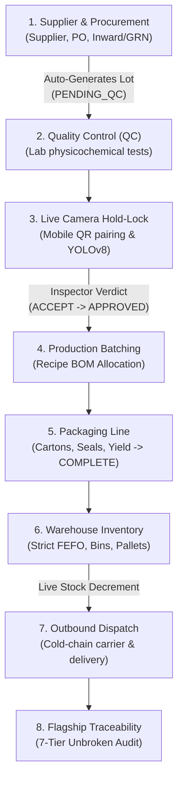

# Food Man - Enterprise AI Food Manufacturing & Traceability System

**Food Man** is a comprehensive, production-grade food manufacturing management and traceability system designed to guarantee food safety, regulatory compliance (ISO 22000, HACCP, FDA FSMA), and real-time operational transparency.

The platform integrates deep-learning visual defect detection (YOLOv8) with end-to-end supply chain execution: procurement intake, mobile camera live QC inspection, recipe-based production batching, packaging certification, FEFO warehouse inventory, cold-chain outbound dispatch, and unbroken multi-tier backward & forward traceability.

---

## Table of Contents
1. [System Architecture](#system-architecture)
2. [Prerequisites & Installation](#prerequisites--installation)
3. [Desktop Launcher Setup](#desktop-launcher-setup)
4. [Starting the Application](#starting-the-application)
5. [Mobile Phone Pairing & Live Camera](#mobile-phone-pairing--live-camera)
6. [One-Page Operational Demo Script (Step-by-Step)](#one-page-operational-demo-script-step-by-step)
7. [AI Vision Engine & Known Limitations](#ai-vision-engine--known-limitations)
8. [Automated Test Suites](#automated-test-suites)

---

## 1. System Architecture



---

## 2. Prerequisites & Installation

### Prerequisites
- **Operating System**: Windows 10 / 11 (64-bit)
- **Python**: Python 3.10, 3.11, or 3.12 installed and added to `PATH`
- **Web Browser**: Microsoft Edge or Google Chrome (used for native desktop app mode)
- **Optional (for Mobile Live Camera over Internet)**: Cloudflare Tunnel (`cloudflared`)

### Step 1: Clone Repository
```bash
git clone https://github.com/aronkoshy2004-crypto/ai-food-manufacturing-system.git "Food man"
cd "Food man"
```

### Step 2: Install Python Dependencies
```bash
pip install -r requirements.txt
```
*Key dependencies include: Flask, Waitress, PyTorch, Ultralytics YOLOv8, Pillow, ReportLab, QRCode, and SQLAlchemy.*

### Step 3: (Optional) Install Cloudflare Tunnel for Remote Phone Camera
For the phone's web browser to access the rear camera stream via `getUserMedia`, an HTTPS connection is required. `FoodMan.bat` automatically spins up a Cloudflare quick tunnel if `cloudflared` is installed:
```powershell
winget install --id Cloudflare.cloudflared
```
*(If `cloudflared` is not installed, the system gracefully falls back to your local LAN address with native photo upload mode).*

---

## 3. Desktop Launcher Setup

To install one-click desktop shortcuts with custom icons on your Windows Desktop:

1. Open PowerShell in the project directory.
2. Run the shortcut generator script:
   ```powershell
   powershell -ExecutionPolicy Bypass -File create_shortcut.ps1
   ```
3. Two shortcuts will immediately appear on your Windows Desktop:
   - **`Food Man`**: Starts the waitress server, initializes the secure tunnel, verifies `/health`, and opens Edge/Chrome in dedicated application mode (`--app=http://localhost:5000`).
   - **`Stop Food Man`**: Instantly terminates the background application server and Cloudflare tunnel processes.

---

## 4. Starting the Application

### Method A: One-Click Desktop Icon (Recommended)
1. Double-click the **Food Man** icon on your Desktop.
2. The launcher runs silently in the background, spins up the production server, verifies uptime via `http://localhost:5000/health`, and launches your browser in clean app window mode.

### Method B: Command Line (CLI)
To run the server manually in terminal mode:
```bash
python wsgi.py
```
Or with Waitress production server directly:
```bash
waitress-serve --port=5000 wsgi:app
```
Then navigate to: [http://localhost:5000](http://localhost:5000)

### Stopping the Application
- Double-click the **Stop Food Man** shortcut on your Desktop, or run:
  ```cmd
  StopFoodMan.bat
  ```

---

## 5. Live Camera Inspection & Laptop Station

Food Man provides three integrated workflows for live visual quality inspection:

### A. Laptop Inspection Station (`/qc/camera-station` or `/qc/station`)
The dedicated Inspection Station provides a high-performance workstation for dock and QC lab inspectors:
- **Internal Automated Session**: Creates an internal live session automatically without requiring token entry or QR codes.
- **Hardware Camera Selector**: Detects and switches between available video inputs (integrated laptop webcam, external USB camera, or phone-as-webcam driver). Choices are preserved in `localStorage`.
- **Flip Image Toggle**: Container-level transform (`transform: scaleX(-1)`) ensures video and overlay bounding box coordinates remain 100% synchronized when using mirrored webcams.
- **Live Steadiness & Lock**: Analyzes 48×36 downsampled frames in real time. Holding steady for ~2.8 seconds automatically triggers a 5-frame high-resolution evaluation lock.
- **Final Result Card & Sign-Off**: Displays material, Good %, Defective %, Best 3 annotated frames, and mandatory Inspector Sign-Off (`✓ Confirm Accept` / `✕ Confirm Reject`) with instant PDF Certificate of Inspection download.

### B. Dashboard Live Inspection Card
On the main Executive Dashboard (`/dashboard`), a dedicated **Live Camera QC Inspection** card allows plant managers to observe operations:
- **"Start Live Inspection" Toggle**: Starts camera hardware **only** when clicked; automatically stops video tracks when leaving the page or clicking Stop.
- **Live In-Card Viewport**: Streams frames at 1 FPS to the YOLOv8 vision engine with real-time HUD guidance.
- **Auto-Refreshing Daily Counters**: Automatically polls every 4 seconds, updating **Samples Checked**, **Pass**, **Review**, and **Reject** totals for today.
- **Latest Final Result Strip**: Shows latest scanned specimen, lot number, Good %, Defective %, verdict pill, and completion time.

### C. Advanced Phone QR Pairing
For remote docks requiring phone camera mobility, navigate to **QC & Inspection** -> **Live Inspection** (`/qc?view=live-inspection`). Click the **"📱 Pair a phone (advanced)"** button to reveal the QR code and HTTPS tunnel link.

---

## 6. Camera Setup & Troubleshooting (Phone-as-Webcam)

Using a smartphone as a wireless or USB webcam delivers superior optical resolution and macro focus compared to standard laptop webcams.

### 3-Step Phone-as-Webcam Setup:
1. **Install App**: Install a phone-as-webcam app (such as [Iriun Webcam](https://iriun.com), [DroidCam](https://dev47apps.com), or [Camo](https://reincubate.com/camo)) on your phone and its companion Windows program on your laptop.
2. **Connect**: Connect via **USB cable** (recommended for lowest latency) or connect both devices to the **same Wi-Fi network / phone hotspot**.
3. **Select Camera**: Open the Inspection Station at `http://localhost:5000/qc/camera-station`, click **⚙️ Camera Setup**, click **📹 Test Camera**, and select your phone camera in the dropdown.

For detailed plain-language troubleshooting (handling *Permission Denied*, *Camera Used by Another App*, *No Camera Found*, *Black Preview*, or *Insecure LAN Mode*), see:  
👉 [`docs/CAMERA_SETUP.md`](file:///c:/Users/L%20E%20N%20O%20V%20O/Food%20man/docs/CAMERA_SETUP.md)

---

## 7. One-Page Operational Demo Script (Step-by-Step)

For presentations and live team demonstrations, refer to the high-impact **One-Page Live Demo Script** featuring a 2–3 minute camera walkthrough and a seamless 5-second emergency fallback:  
👉 [`docs/ONE_PAGE_DEMO_SCRIPT.md`](file:///c:/Users/L%20E%20N%20O%20V%20O/Food%20man/docs/ONE_PAGE_DEMO_SCRIPT.md)

### End-to-End Enterprise Lifecycle Overview:

| Step | Module & Action | Details & Expected Output |
| :---: | :--- | :--- |
| **1** | **System Launch** | Double-click the **Food Man** desktop icon. The application opens in standalone window mode at `http://localhost:5000`. |
| **2** | **Procurement Login** | Sign in as **Procurement Officer** (`procurement@foodman.vn`). Navigate to **Procurement** -> **Suppliers**. |
| **3** | **Supplier Creation** | Click **Add Supplier** -> Name: `Highland Agro Organic Collective`, Contact: `Nguyen Van Binh`, Rating: `4.95` -> Click **Save Supplier**. |
| **4** | **Purchase Order (PO)** | Navigate to **Purchase Orders** -> Click **Create PO** -> Select `Highland Agro Organic Collective` -> Add line item: `Peanut`, Qty: `2,500 kg`, Price: `34,000 VND` -> Click **Submit PO**. Status displays `APPROVED`. |
| **5** | **Inward / GRN Receipt** | Navigate to **Goods Receipt Notes** -> Click **New GRN Intake** -> Select the PO -> Quantity Received: `2,500 kg` -> Click **Complete GRN**. The system automatically generates raw material lot **`LOT-RM-2026-xxx`** with status **`PENDING_QC`**. |
| **6** | **QC Sampling & Lab Entry** | Sign in as **QC Inspector** (`qc@foodman.vn`). Under **QC Queue**, locate the pending lot -> Click **Record Sample** -> Enter lab parameters: Moisture `6.4%`, Aflatoxin B1 `0.15 ppb`, Purity `99.6%` (All Pass). |
| **7** | **Inspection Station QC** | Navigate to **QC** -> **Inspection Station** (`/qc/camera-station`).<br/>1. Select the pending lot in the Target Lot dropdown.<br/>2. Position phone or webcam over sample kernels.<br/>3. Hold steady for 2.8 seconds; system locks 5 frames and displays **Final Result Card**: `Material: Peanut`, `Good: 100%`, `Suggestion: Pass`.<br/>4. Click **Confirm Accept** -> Lot status updates to **`APPROVED`**; click **Download PDF Report**.<br/>*(Emergency fallback: Use YOLO AI File Upload mode if physical camera is unavailable).* |
| **8** | **Production Batching** | Sign in as **Production Manager** (`production@foodman.vn`). Navigate to **Production** -> Click **New Batch Wizard** -> Select `Pure Roasted Peanut Oil 1L` -> Target: `1,000 Bottles`.<br/>The wizard checks BOM inventory, verifies the newly QC-approved peanut lot, and decrements 2,200 kg from stock -> Click **Start Batch**.<br/>Advance through the 5 production stages (Preparation -> Mixing -> Extraction -> Filtration -> Bottling). |
| **9** | **Packaging Certification** | On the completed batch drawer, click **Record Packaging** -> Enter: `1,000 cartons`, `4 seal rolls`, `5 waste items` -> Click **Certify Packaging**. Batch status updates to **`COMPLETE`**. |
| **10** | **Warehouse FEFO Ingestion** | Sign in as **Warehouse Supervisor** (`warehouse@foodman.vn`). Under **Warehouse** -> Click **Admit Finished Batch** -> Batch is ingested into FEFO inventory (assigned SKU code, storage bin `Zone C - Flow Rack`, pallet code, and expiry urgency `FRESH`). |
| **11** | **Outbound Dispatch** | Navigate to **Dispatches** -> Click **Create Dispatch** -> Customer: `WinCommerce (WinMart)`, Carrier: `FoodMan Cold Chain Fleet`, Quantity: `400 cartons` -> Click **Dispatch**.<br/>**Live Decrement**: Available warehouse inventory automatically drops from 1,000 to 600 cartons. Advance dispatch status to **`DELIVERED`**. |
| **12** | **Full Traceability Audit** | Navigate to **Traceability**. In the omni-search bar, type the **Batch Code** (e.g. `LOT-2026-009`) or **Lot Number**.<br/>The unbroken **7-tier interactive traceability chain** renders across all tiers: **Supplier -> Inward Lot -> QC/AI Inspection -> Production Batch -> Packaging Run -> Warehouse FEFO -> Outbound Dispatch**. |

---

## 8. AI Vision Engine & Known Limitations

The vision engine utilizes an Ultralytics YOLOv8 architecture fine-tuned on multi-commodity food grains (Peanuts, Corn, Sunflower Seeds).

Detailed technical analysis and data engineering roadmaps are documented in [`docs/AI_MODEL_LIMITATIONS.md`](file:///c:/Users/L%20E%20N%20O%20V%20O/Food%20man/docs/AI_MODEL_LIMITATIONS.md). A brief operational summary:

1. **Peanut Mold Recall Limitation**: Fungal defect recall on peanuts plateaus at **~42%–57%** due to dataset sample ceilings (10,227 moldy peanut training instances). Very light or nascent surface mold can be missed optically.
2. **No Sunflower Mold Training Data**: Genuine fungal sunflower seed data is currently zero (`0` training instances). Sunflower mold detection is disabled in production to avoid false positives; manual lab testing is mandatory.
3. **Dense Peanut Piles Read as Corn**: Due to training dataset imbalance (25,000+ cluster corn examples vs 213 isolated peanut photos), dense multi-kernel peanut piles can be misclassified as corn.
4. **Good % Is a Visual Estimate (Not a Lab Measurement)**: The optical score reflects visible surface features only. It **cannot detect chemical mycotoxins (Aflatoxin B1), moisture content, or internal rot**. AI scores are advisory; human inspector sign-off and COA laboratory tests are strictly required.
5. **Inference Speed**: Model inference runs on CPU at approximately **one frame per second (~1 FPS)**. The live stream throttles frame transmissions accordingly to preserve server responsiveness.

---

## 9. Automated Test Suites

The repository contains comprehensive end-to-end integration test suites:

| Test Suite | Purpose | Execution Command |
| :--- | :--- | :--- |
| **Phase 2 Camera Station** | Laptop Inspection Station, camera dropdown, flip toggle, 5-frame lock, and PDF dossier | `python -m unittest scratch/test_phase2_camera_station.py` |
| **Phase 3 Dashboard Card** | Live inspection card, camera lifecycle, 1 FPS stream, and auto-refreshing daily counters | `python -m unittest scratch/test_phase3_dashboard_live_card.py` |
| **Phase 4 Setup & Diagnostics**| Camera setup panel, device enumeration, plain-language error mapping, and checklist | `python -m unittest scratch/test_phase4_camera_setup_helper.py` |
| **Phase 5 Full Regression** | Cross-module verification, security gates, phone capture flow, and dashboard integration | `python -m unittest scratch/test_phase5_full_regression.py` |
| **Phase 1 Live Inspection** | QR pairing, tokens, frame upload limits, and live session state (17 tests) | `python scratch/test_phase1_live_inspection.py` |

To run all camera station automated tests:
```bash
python -m unittest scratch/test_phase2_camera_station.py scratch/test_phase3_dashboard_live_card.py scratch/test_phase4_camera_setup_helper.py
```

To run the complete Phase 5 full workflow integration test:
```bash
python scratch/test_phase5_full_workflow.py
```

---

## License & Compliance
This software is developed for food processing facility management under ISO 22000, HACCP, and GMP standards. All rights reserved.
