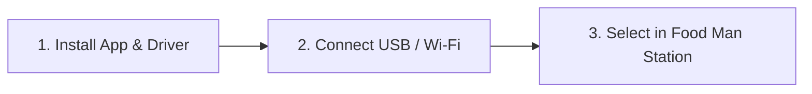

# Food Man QC Inspection Station — Camera Setup & Troubleshooting Guide

## 1. Overview & Vision Architecture

The **Food Man QC Inspection Station** (`/qc/camera-station` or `/qc/station`) enables laboratory and intake inspectors to verify raw material shipments (Corn, Peanuts, Sunflower Seeds) in real time using a laptop webcam, external USB webcam, or connected smartphone camera.

### Key Vision Pipeline Specifications:
- **Target Resolution**: `1280 × 720` (16:9 HD) ideal. The system automatically adapts to standard resolutions supported by the device.
- **Inference Rate**: ~1 frame per second (1 FPS) sent to the YOLOv8 neural network to optimize CPU efficiency.
- **Steadiness Gate**: Downsampled 48×36 luminance analyzer requiring ~2.8 seconds of steady holding before initiating multi-frame evaluation.
- **Multi-Frame Lock**: 5 sequential high-resolution frames captured and averaged to determine final lot verdict (**Pass / Review / Reject**).

---

## 2. Phone-as-Webcam 3-Step Setup Checklist

Using a modern smartphone camera offers significantly higher optical resolution, superior macro focus, and better low-light sensitivity than typical built-in laptop webcams.

### Step 1: Install Phone App & Laptop Companion Driver
Choose one of the following recommended phone-as-webcam solutions:
1. **Iriun Webcam** *(Recommended)*:
   - Phone app: Install **Iriun 4K Webcam** from Google Play Store or Apple App Store.
   - Laptop driver: Download and install the free Windows client from [iriun.com](https://iriun.com).
2. **DroidCam**:
   - Phone app: Install **DroidCam Webcam** from Play Store / App Store.
   - Laptop driver: Install the Windows client from [dev47apps.com](https://www.dev47apps.com).
3. **Camo (Reincubate)**:
   - Phone app: Install **Camo** from Play Store / App Store.
   - Laptop driver: Install the Camo Windows Studio software from [reincubate.com/camo](https://reincubate.com/camo).

### Step 2: Connect Phone and Laptop
- **Option A (Recommended — Lowest Latency)**: Connect your phone to your laptop using a **USB data cable**. Enable "USB Debugging" (Android) or tap "Trust This Computer" (iOS).
- **Option B (Wireless)**: Connect both your phone and laptop to the **same Wi-Fi network**, or turn on your phone's **Personal Hotspot** and connect your laptop to it.

### Step 3: Select Camera in Food Man
1. Launch the phone-camera app on your phone.
2. Launch the companion program on your Windows laptop.
3. Open the **Inspection Station** at `http://localhost:5000/qc/camera-station`.
4. In the **Camera dropdown**, select your virtual camera (e.g., `Iriun Webcam` or `DroidCam Source 1`).
5. Your choice is automatically saved in `localStorage` and remembered for all future inspections.

---

## 3. In-Station Camera Setup & Diagnostics Helper

The Inspection Station includes a built-in diagnostic helper accessible via the **⚙️ Camera Setup** button on the station toolbar.

### Diagnostic Helper Capabilities:
- **📹 Test Camera**: Initiates a standalone test preview stream without altering active QC inspection state.
- **Detected Cameras List**: Dynamically enumerates all connected video devices (`navigator.mediaDevices.enumerateDevices()`) with device name, hardware ID, and active status.
- **Resolution Telemetry**: Displays exact live resolution (e.g., `1280 × 720 (16:9 HD)`) and frame delivery confirmation.
- **Automatic Black-Screen Detection**: Samples luminance after stream start to immediately flag disconnected phone-camera drivers.

---

## 4. Plain-Language Troubleshooting & Common Errors

The system provides plain-language diagnostics for all common camera states:

### 1. Permission Denied
> [!WARNING]
> **Symptom**: Red alert banner: *"🚫 Camera Permission Denied: Your browser is blocking camera access."*
- **Cause**: Browser security blocked the camera prompt or permission was previously denied for `localhost`.
- **Resolution**:
  1. Click the **padlock icon 🔒** or **camera icon 🎥** in the browser address bar (to the left of `http://localhost:5000`).
  2. Set **Camera** permission from *Block* to **Allow**.
  3. Reload the page (`Ctrl + F5` or `F5`).

---

### 2. Camera Used by Another Application
> [!WARNING]
> **Symptom**: Amber alert banner: *"⚠️ Camera Used by Another App: Your camera is currently locked or in use."*
- **Cause**: Windows allows only one application exclusive access to a DirectShow webcam device at a time.
- **Resolution**:
  1. Check for and close active video call programs:
     - **Zoom**, **Microsoft Teams**, **Skype**, **Google Meet**, **Discord**, or **Slack**.
  2. Check for other browser tabs running camera feeds (e.g. earlier tests or video conferencing tabs) and close them.
  3. Click **"📹 Test Camera"** in the Camera Setup panel to confirm access is restored.

---

### 3. No Camera Found
> [!CAUTION]
> **Symptom**: Grey alert banner: *"🔍 No Camera Found: No camera hardware was detected on this computer."*
- **Cause**: The laptop has no built-in webcam, or the external USB webcam/phone driver is unplugged or disabled.
- **Resolution**:
  1. If using a USB webcam: Unplug and firmly re-insert the USB cable into a direct USB 3.0 port.
  2. If using a phone camera: Ensure the Windows companion application (Iriun or DroidCam) is running in your Windows system tray.
  3. Verify in Windows: Open Windows **Device Manager** -> **Cameras** and confirm device status is "This device is working properly".
  4. In the Food Man Camera Setup panel, click **"↻ Rescan Devices"**.

---

### 4. Black Preview
> [!IMPORTANT]
> **Symptom**: Amber alert banner: *"⬛ Black Preview Detected: The video stream is active but displays a solid black frame."*
- **Cause**: The phone-as-webcam virtual driver on Windows is broadcasting, but the phone itself is disconnected, the phone app is closed, or the phone screen went to sleep.
- **Resolution**:
  1. Unlock your phone and ensure the camera app (Iriun, DroidCam, Camo) is active on the screen.
  2. If using Wi-Fi: Confirm both phone and laptop IP addresses are on the same local subnet.
  3. If using USB: Reconnect the USB cable and verify USB connection mode is set to "File Transfer" or "Tethering / MIDI" as required by the app.
  4. In the Windows companion client, verify you can see the live feed from your phone.
  5. Click **"Test Camera"** in the Food Man panel to re-verify.

---

### 5. Insecure LAN HTTP Restriction
> [!NOTE]
> **Symptom**: Yellow top warning banner: *"⚠️ Insecure LAN Mode: Browser blocks camera access over plain HTTP on LAN."*
- **Cause**: Modern browsers (Chrome, Edge, Firefox, Safari) enforce strict security: WebRTC `getUserMedia()` is permanently blocked over plain HTTP on private IP addresses (e.g., `http://192.168.1.50:5000`).
- **Resolution**:
  - **Option 1 (Localhost)**: If accessing directly from the laptop running Food Man, use `http://localhost:5000/qc/camera-station` or click the **"Open localhost version"** button in the warning banner.
  - **Option 2 (HTTPS Tunnel)**: For remote dock access, launch an HTTPS tunnel service (e.g. ngrok or Cloudflare Tunnel) to provide an encrypted HTTPS address.

---

## 5. Optimal Optical Setup for YOLOv8 AI Inspection

To achieve maximum accuracy with the fine-tuned YOLOv8 visual defect engine:

| Inspection Factor | Recommendation | What to Avoid |
| :--- | :--- | :--- |
| **Distance** | Hold camera **15 cm to 25 cm** above specimen tray | Do not position camera > 40 cm away (kernels become too small) |
| **Sample Layout** | Spread **3 to 30 kernels** across the view | Avoid single isolated kernels or completely heaped piles > 3 layers deep |
| **Lighting** | Even white desk lamp or daylight (min 40 luma) | Harsh directional shadows or dim warehouse corners |
| **Background** | Clean matte white paper or neutral inspection tray | Glare-heavy reflective steel surfaces or patterned tablecloths |
| **Orientation** | Use the **⇄ Flip Image** toggle if using front-facing camera | Upside-down or constantly vibrating handheld feeds |

---

*Document Version: 1.0 (Phase 4 Inspection Station Release)*  
*Maintained by: Food Man QA & AI Engineering*
